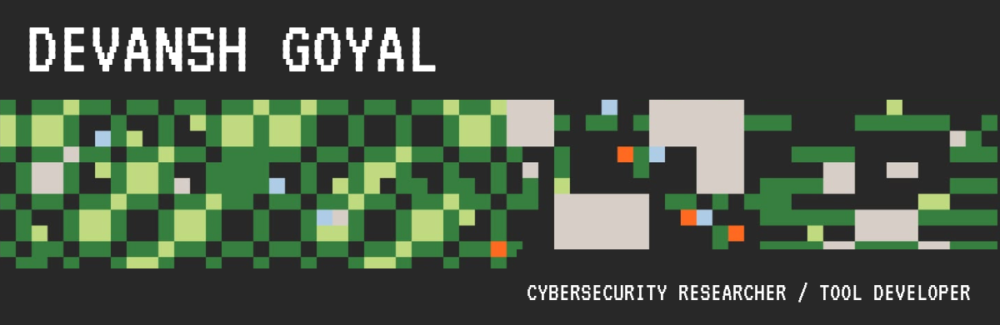
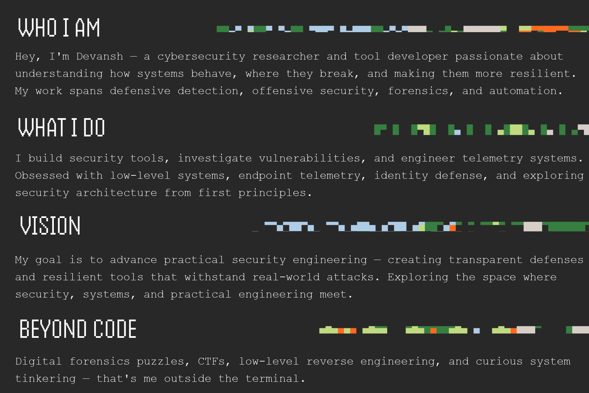
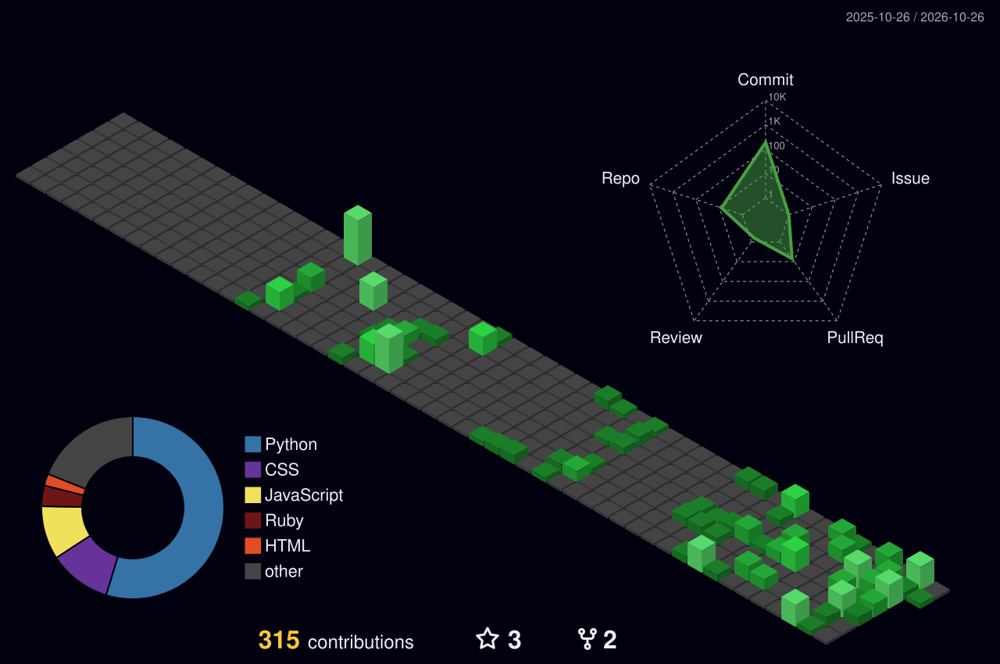
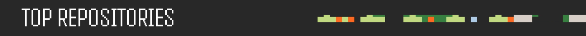

  

  

 

<table border="0" cellspacing="0" cellpadding="0">
  <tr>
    <td width="200" align="center">
      
    </td>
    <td align="center">
      <table border="0" cellspacing="0" cellpadding="8">
        <tr>
          <th>Linkedin</th>
          <th>GitHub</th>
          <th>Gmail</th>
          <th>Portfolio</th>
        </tr>
        <tr>
          <td align="center">   </td>
          <td align="center">   </td>
          <td align="center">   </td>
          <td align="center">   </td>
        </tr>
      </table>
    </td>
    <td width="200" align="center">
      
    </td>
  </tr>
</table>

  

  

  <table width="100%">
    <!-- ROW 1: Security, Forensics & Telemetry -->
    <tr>
      <td align="center" width="10%"> Wireshark</td>
      <td align="center" width="10%"> Burp Suite</td>
      <td align="center" width="10%"> Metasploit</td>
      <td align="center" width="10%"> Kali Linux</td>
      <td align="center" width="10%"> Linux</td>
      <td align="center" width="10%"> Splunk</td>
      <td align="center" width="10%"> Tor</td>
      <td align="center" width="10%"> OWASP</td>
      <td align="center" width="10%"> Bash</td>
      <td align="center" width="10%"> PowerShell</td>
    </tr>
    <!-- ROW 2: Languages & Systems Programming -->
    <tr>
      <td align="center" width="10%"> Python</td>
      <td align="center" width="10%"> Rust</td>
      <td align="center" width="10%"> C</td>
      <td align="center" width="10%"> C++</td>
      <td align="center" width="10%"> Java</td>
      <td align="center" width="10%"> Go</td>
      <td align="center" width="10%"> Postgres</td>
      <td align="center" width="10%"> MySQL</td>
      <td align="center" width="10%"> SQLite</td>
      <td align="center" width="10%"> RegEx</td>
    </tr>
    <!-- ROW 3: Security Automation, Cloud & Infrastructure -->
    <tr>
      <td align="center" width="10%"> Docker</td>
      <td align="center" width="10%"> Git</td>
      <td align="center" width="10%"> GitHub</td>
      <td align="center" width="10%"> Actions</td>
      <td align="center" width="10%"> AWS</td>
      <td align="center" width="10%"> Nginx</td>
      <td align="center" width="10%"> Cloudflare</td>
      <td align="center" width="10%"> Postman</td>
      <td align="center" width="10%"> Vercel</td>
      <td align="center" width="10%"> VS Code</td>
    </tr>
  </table>

 

<picture>
  <source media="(prefers-color-scheme: dark)" srcset="./assets/github-contribution-grid-snake-dark.svg">
  <source media="(prefers-color-scheme: light)" srcset="./assets/github-contribution-grid-snake.svg">
  
</picture>

  

  
  

 

  
  

 

  

